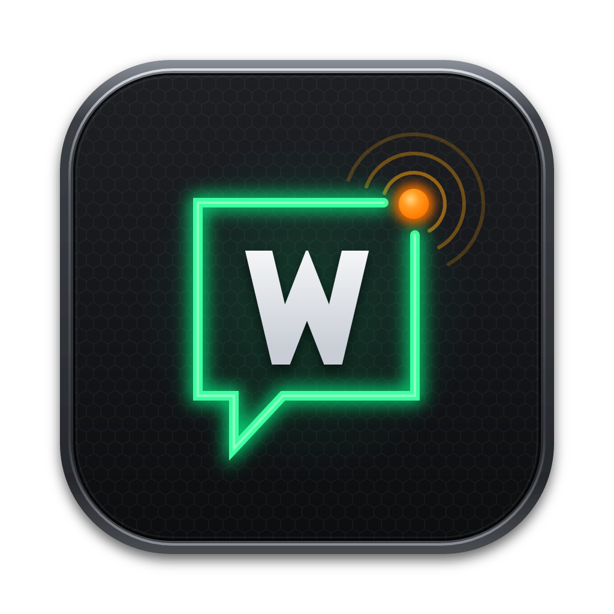
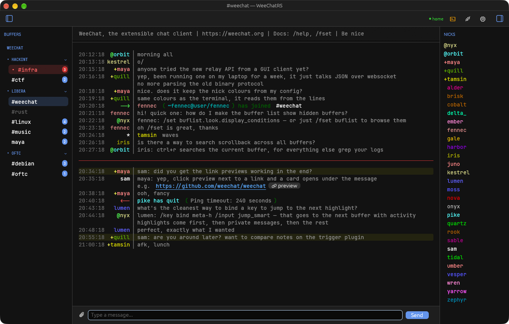
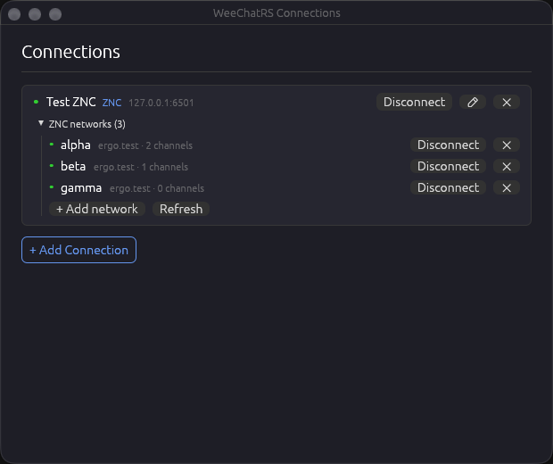
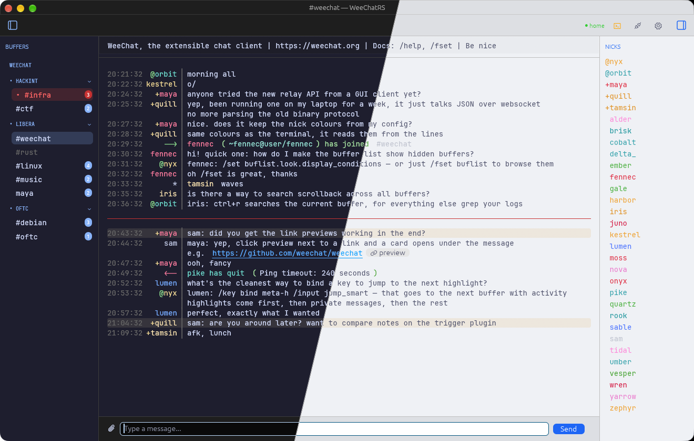
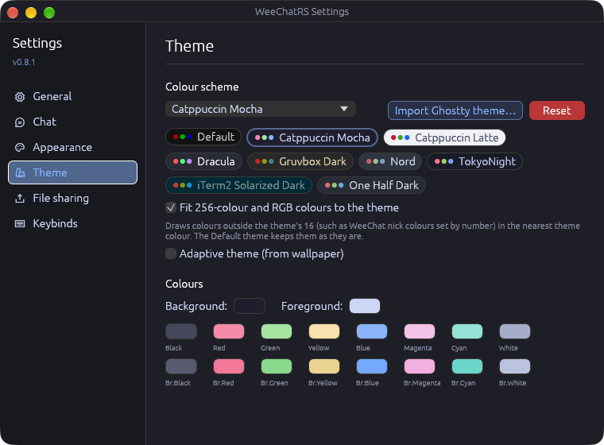
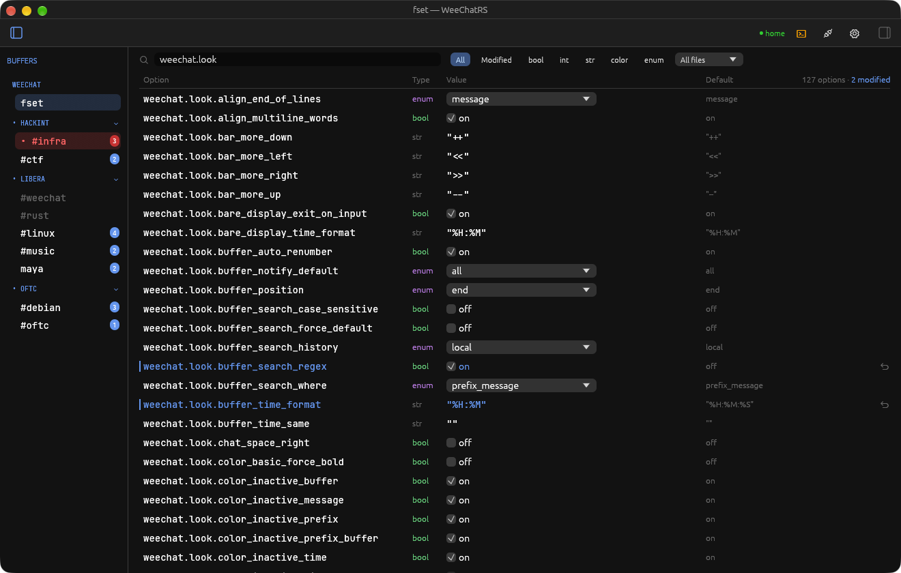
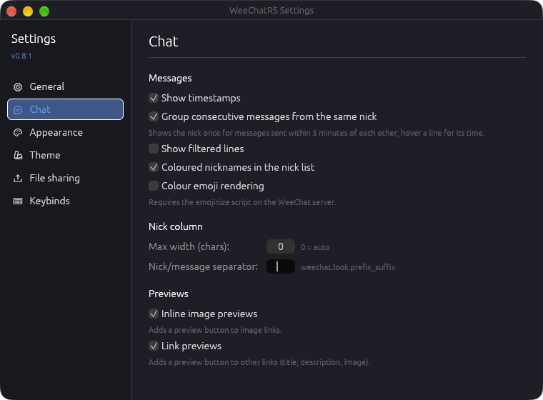
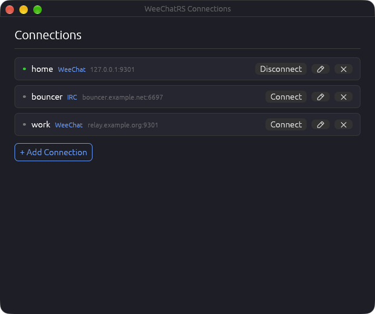
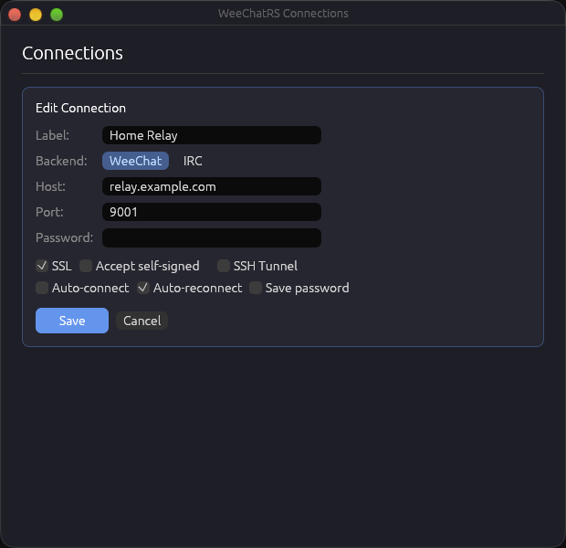
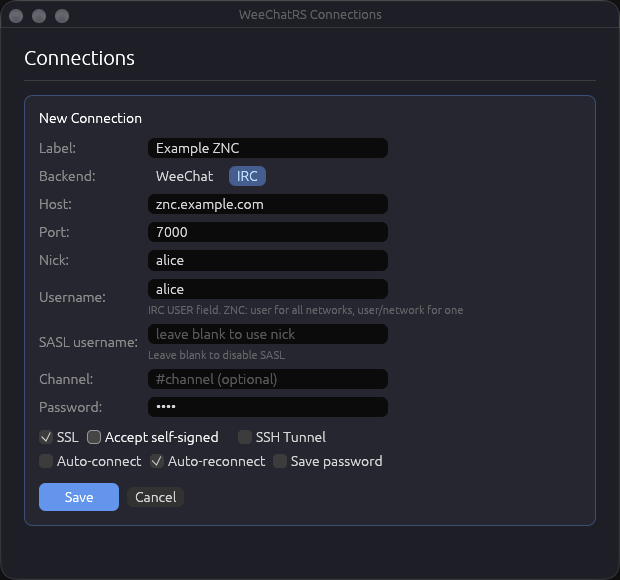

<div align="center">
  
  <h1>WeeChatRS</h1>
  <p>A modern, high-performance GUI client for <a href="https://weechat.org/">WeeChat</a> Relay and IRC,<br>
  with first-class support for the <a href="https://soju.im/">soju</a> and <a href="https://znc.in/">ZNC</a> bouncers.<br>
  Built in Rust using <code>egui</code> and <code>tokio</code>.<br>
  Real-time chat with a polished native UI, full ANSI color support, and zero runtime dependencies.</p>
  <p><a href="#install">Download</a> · <a href="#connecting">Connecting</a> · <a href="#features">Features</a> · <a href="docs/bouncers.md">Bouncers</a> · <a href="CONTACT.md">Contact</a></p>
</div>



*Buffers grouped by network with unread and highlight counts, the unread divider, grouped messages, and a nick list in the same colours as the chat*

## Highlights

- **One client for WeeChat and IRC**: a WeeChat Relay (API v2 over WebSocket), any IRC server, or a soju or ZNC bouncer, side by side.
- **Every bouncer network from one login**: each network in its own group; history, unread counts and ZNC network management included.
- **Themes**: a hand-picked set bundled (Darkweb, Catppuccin, Dracula, Gruvbox, Nord, TokyoNight and more), any Ghostty theme of your own, or colours taken from your wallpaper.
- **Inline images and link previews**, file sharing with `/share`, and `/np` for what's playing.
- **WeeChat's options as a real settings table** with `/fset`.
- **Native on macOS, Linux and Windows**, with desktop notifications and an SSH tunnel built in.

## Install

Download the latest release from [GitHub](https://github.com/rnocx/WeeChatRS/releases/latest):

| Platform | File | Notes |
| :--- | :--- | :--- |
| macOS (Apple Silicon + Intel) | `WeeChatRS-<version>-macos-universal.dmg` | Drag WeeChatRS to Applications. Signed and notarized. |
| Linux x86_64 / ARM64 | `WeeChatRS-<version>-linux-<arch>.zip` | Unzip and run `./install.sh` for a per-user install (`--uninstall` removes it), or run `./weechat-rs` directly. Needs glibc 2.28 or later. |
| Windows x86_64 | `WeeChatRS-<version>-windows-x86_64.zip` | Not code-signed, so SmartScreen may warn on first launch: *More info → Run anyway*. |

Checksums are in each release's `SHA256SUMS`. To build it yourself, see [BUILDING.md](BUILDING.md).

## Connecting

Open **Connections** (`⌘⇧C` / `Ctrl+Shift+C`) and add a connection. Pick the backend for what you run:

| You have | Backend | What you need |
| :--- | :--- | :--- |
| WeeChat (4.0.0 or later) | **WeeChat** | The relay's host, port and password ([set up the relay](#weechat-relay)) |
| An IRC server | **IRC** | Host, port, nick; SASL username and password if you use them |
| A soju bouncer | **IRC** | Your soju username and password |
| A ZNC bouncer | **IRC** | Your ZNC username and password |
| An Injected account | **Injected** | Your session token ([setup and limitations](docs/injected.md)) |

Every connection can go through an **SSH tunnel** (your SSH agent, `~/.ssh` keys or a saved password), reconnects on its own when it drops, and saves its password in the system keychain if you ask it to.

### WeeChat relay

WeeChatRS talks to the WeeChat **Relay API v2**. In WeeChat:

```
/relay add api 9000
/set relay.network.password "your-password"
```

For TLS, load a certificate and use a `tls.api` relay instead:

```
/set relay.network.ssl_certfile /path/to/cert.pem
/relay add tls.api 9001
```

`/relay listfull` should show the `api` relay as `listening`. Connect with that host, port and password; allow the port through any firewall if you connect remotely.

> WeeChatRS sends the WebSocket origin `weechatrs://app`. If you restrict origins with `relay.network.websocket_allowed_origins`, allow it, or the relay refuses the connection with `403 Forbidden`:
> ```
> /set relay.network.websocket_allowed_origins "^weechatrs://app$"
> ```

### IRC servers

Add an **IRC** connection with the server's host and port, your nick, and TLS on or off. A password is sent as the server password and, when the server offers SASL, used to log in with SASL PLAIN as *SASL username* (or your nick). It speaks a wide range of IRCv3: see [IRC protocol support](docs/irc.md).

### soju and ZNC

Log in with just your bouncer username and **every network opens**, each in its own group in the buffer list; put a network in the username (`alice/libera`) to open only that one. History is loaded on connect, and unread counts start from where you left off.

With ZNC, the Connections window also lists your networks and adds, deletes, connects and disconnects them:



The details of both, from soju's read markers and search to ZNC's playback module, are in [Bouncers](docs/bouncers.md).

## Features

### Chat
- **ANSI and IRC colours**: 16-color, 256-color and TrueColor, IRC formatting codes, and nick colours from the chat in the nick list.
- **Read position**: the unread divider shows where you left off; read markers sync with WeeChat and soju.
- **Inline images**: a `🖼 preview` button on image links (`.png` `.jpg` `.gif` `.webp`) loads them into the chat.
- **Link previews**: a `🔗 preview` button on other links shows the page's title, description and image.
- **Search**: `⌘/Ctrl + F` filters the buffer; on soju it also searches the server's history.
- **Tab completion**: nicks and emoji (`:fire` + Tab → 🔥); on WeeChat also commands, options and their values, completed by WeeChat itself.
- **Context menus**: on messages (copy message or link), on nicks (query, whois, mention, copy, CTCP, and op, voice, kick and ban in channels) and on buffers (mute, hide, leave, close).
- **Buffer list**: grouped by network, drag and drop to reorder (the order is kept), and a quick switcher (`⌘/Ctrl + P`).
- **`/fset`**: WeeChat's options as a table, with the default and inherited values, ranges and descriptions, switches for booleans, menus for enums, and filters. Your own fset format is put back when you leave it.

### Commands
- **`/share [path]`**: uploads a file and posts the link (no path opens a file picker; dropping a file on the window or the paperclip button does the same). Uses Jirafeau, your own server or the default one, or Litterbox, with a progress bar and Cancel.
- **`/np`**: posts what's playing: on macOS whatever the Now Playing widget shows (music apps and browsers), on Linux the first playing MPRIS player (`playerctl`), on Windows the system media controls.
- **`/sysinfo`**: posts your OS, CPU and memory.

### Look and settings
- **Themes**: 14 bundled themes (Darkweb by default, Catppuccin Mocha and Latte, Dracula, Gruvbox Dark and Light, Nord, TokyoNight, Solarized Dark, One Half Dark, Batman, Doom One, Glacier, Monokai Pro Light) with search and quick buttons, your own Ghostty themes from `~/.config/ghostty/themes`, or an imported theme file; all 16 colours editable, and 256-colour and RGB colours fitted to the theme.
- **Adaptive theme**: colours derived from your desktop wallpaper, following it when it changes.
- **Window**: opacity, with native background blur on macOS; font, font size, timestamps and nick column alignment.
- **Notifications**: desktop notifications for highlights and private messages on macOS, Windows and Linux.
- **Keyboard**: every shortcut can be rebound in Settings → Keybinds.

<details>
<summary><b>Keyboard shortcuts</b></summary>

All of them can be rebound in **Settings → Keybinds**.

| Shortcut | Action |
| :--- | :--- |
| `⌘/Ctrl + ↑ / ↓` | Cycle buffers |
| `⌘/Ctrl + B` | Toggle buffer list |
| `⌘/Ctrl + N` | Toggle nick list |
| `⌘/Ctrl + T` | Toggle toolbar |
| `⌘/Ctrl + F` | Toggle message search |
| `⌘/Ctrl + K` | Jump to next unread buffer |
| `⌘/Ctrl + P` | Quick switcher — fuzzy-find a buffer |
| `⌘/Ctrl + ,` | Open Settings |
| `⌘/Ctrl + Shift + C` | Open Connections |
| `Alt + 1–9` | Jump to buffer by number |
| `Tab` | Complete nick, emoji or WeeChat command (cycles matches) |
| `Arrow ↑ / ↓` | Cycle command history (input bar) |
| `Enter` | Send message |

</details>

<details>
<summary><b>More screenshots</b></summary>



*Themes — the same channel in Catppuccin Mocha and Catppuccin Latte, two of the bundled Ghostty themes*



*Theme page — searchable theme list, quick buttons drawn in each theme's colours, Ghostty theme import, and the 16-colour editor*



*fset — browse and edit WeeChat options: dropdowns for enums, checkboxes for booleans, modified options marked with a reset button*



*Settings — chat options, nick column alignment, and inline image and link previews*



*Connections — WeeChat relays and IRC servers side by side, each with its own status*



*WeeChat Relay connection — host, port, password, SSL toggle, and optional SSH tunnel*



*IRC, soju or ZNC connection — server, port, nick, username (for ZNC: `user` for all networks, `user/network` for one), SASL auth, and TLS options*

</details>

## Platform notes

| Platform | Status |
| :--- | :--- |
| macOS (Apple Silicon + Intel) | Fully supported |
| Linux x86_64 / ARM64 | Supported |
| Windows x86_64 | Supported |

- **Linux:** dropping files onto the window works on X11 but not yet under Wayland; use `/share <path>`, `/share` or the paperclip button instead. The file picker uses the desktop's file-chooser portal (`xdg-desktop-portal`), standard on GNOME and KDE; `/share <path>` works without it.
- **Windows:** window transparency needs *Transparency effects* on (Settings → Personalization → Colors); without it the window has a solid background.

## Contributing

See [CONTRIBUTING.md](CONTRIBUTING.md) for guidelines, [BUILDING.md](BUILDING.md) to build it, and [Architecture](docs/architecture.md) for how the code is laid out. Planned features and known issues are in [todo.md](todo.md).

## License

MIT License — Copyright (c) 2026

The bundled color themes in `assets/themes`, except Darkweb, come from [iTerm2-Color-Schemes](https://github.com/mbadolato/iTerm2-Color-Schemes) in Ghostty's format (MIT, see `assets/themes/LICENSE`); each theme belongs to its author.

---

[Contact](CONTACT.md)
