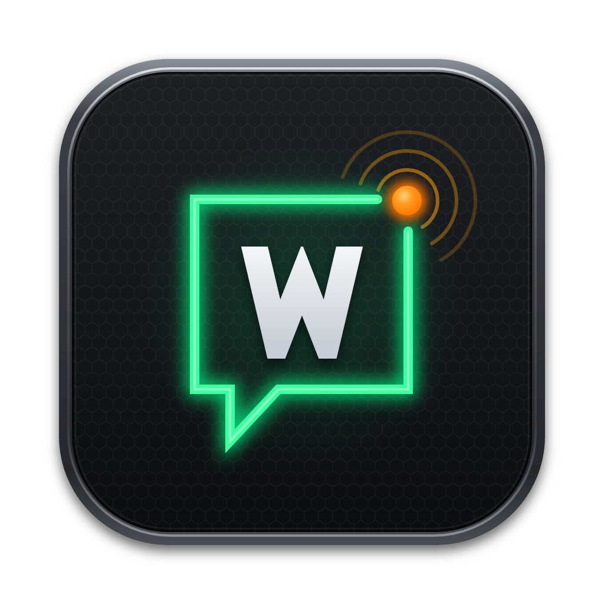
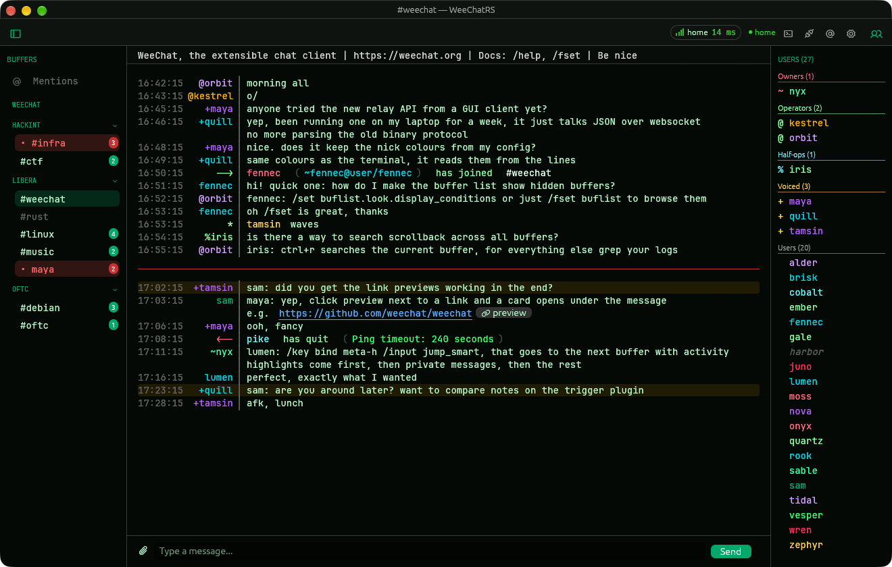
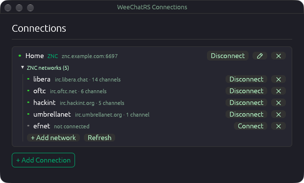
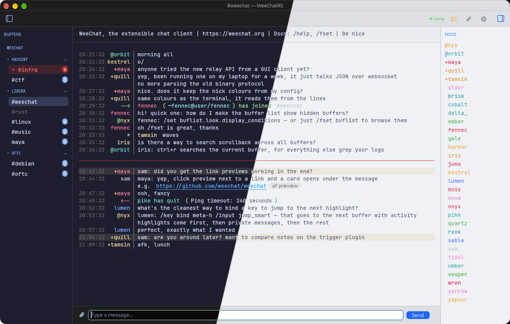
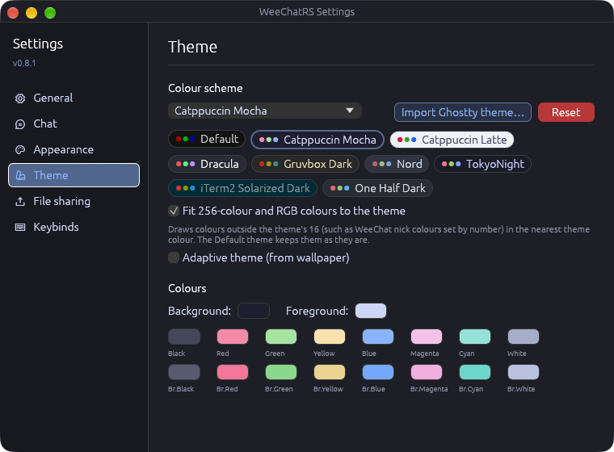
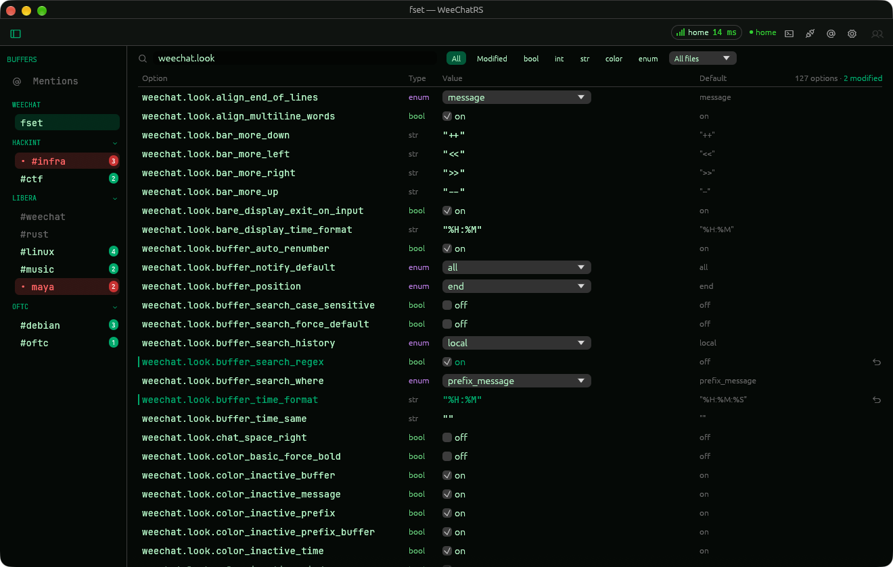
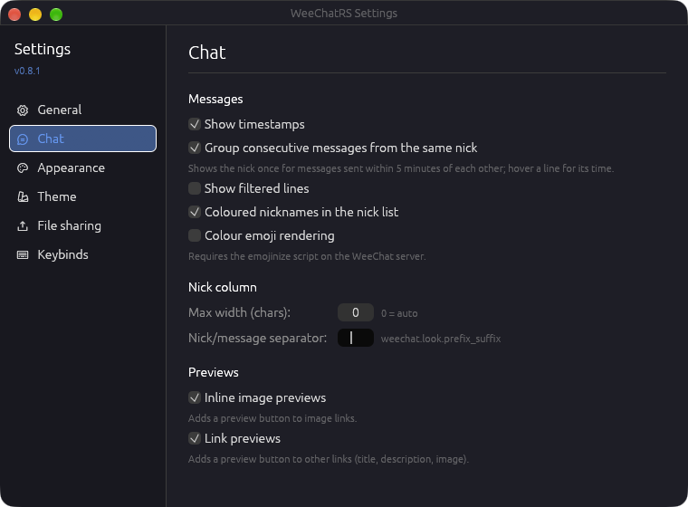
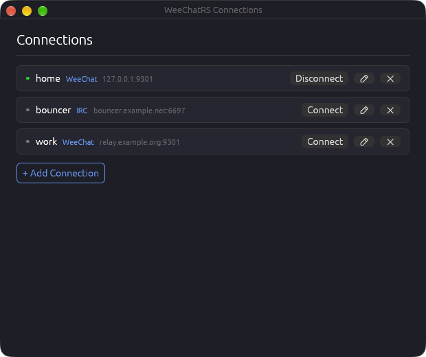
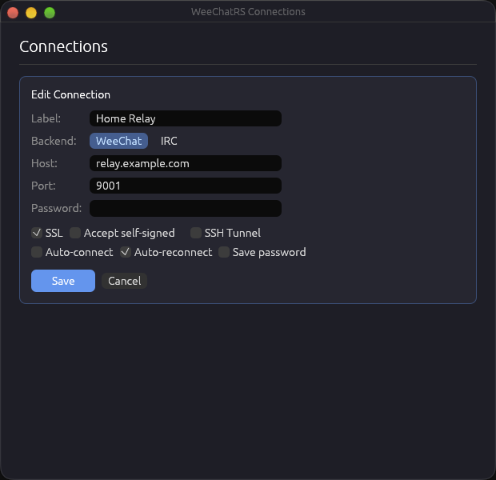
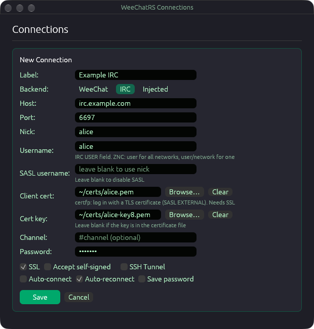

<div align="center">
  
  <h1>WeeChatRS</h1>
  <p>A desktop client for the <a href="https://weechat.org/">WeeChat</a> relay and for IRC,<br>
  the <a href="https://soju.im/">soju</a> and <a href="https://znc.in/">ZNC</a> bouncers included.<br>
  Written in Rust with <code>egui</code> and <code>tokio</code>, for macOS, Linux and Windows.</p>
  <p><a href="#install">Download</a> · <a href="#connecting">Connecting</a> · <a href="#features">Features</a> · <a href="docs/bouncers.md">Bouncers</a> · <a href="CONTACT.md">Contact</a></p>
</div>



*Buffers grouped by network with unread and highlight counts, the unread divider, grouped messages, and a nick list in the same colours as the chat*

## Highlights

- **One client for WeeChat and IRC**: a WeeChat Relay (API v2 over WebSocket), any IRC server, or a soju or ZNC bouncer, side by side.
- **Every bouncer network from one login**, each in its own group, with history and unread counts. On ZNC you can manage the networks too.
- **Themes**: a hand-picked set bundled (Darkweb, Catppuccin, Dracula, Gruvbox, Nord, TokyoNight and more), any Ghostty theme of your own, or colours taken from your wallpaper. Pick a dark and a light theme to follow the system's appearance.
- **Inline images and link previews**, file sharing with `/share`, and `/np` for what's playing.
- **WeeChat's options as a real settings table** with `/fset`.
- **Native on macOS, Linux and Windows**, with desktop notifications and an SSH tunnel built in.

## Install

Download the latest release from [GitHub](https://github.com/rnocx/WeeChatRS/releases/latest):

| Platform | File | Notes |
| :--- | :--- | :--- |
| macOS (Apple Silicon + Intel) | `WeeChatRS-<version>-macos-universal.dmg` | Drag WeeChatRS to Applications. Signed and notarized. |
| Linux x86_64 / ARM64 | `WeeChatRS-<version>-linux-<arch>.zip` | Unzip and run `./install.sh` for a per-user install (`--uninstall` removes it), or run `./weechat-rs` directly. Needs glibc 2.28 or later. The Injected sign-in window also needs WebKitGTK 4.1. |
| Windows x86_64 | `WeeChatRS-<version>-windows-x86_64.zip` | Not code-signed, so SmartScreen may warn on first launch: *More info → Run anyway*. |

Checksums are in each release's `SHA256SUMS`. To build it yourself, see [BUILDING.md](BUILDING.md).

## Connecting

Open **Connections** (`⌘⇧C` / `Ctrl+Shift+C`) and add a connection. Pick the backend for what you run:

| You have | Backend | What you need |
| :--- | :--- | :--- |
| WeeChat (4.0.0 or later) | **WeeChat** | The relay's host, port and password ([set up the relay](#weechat-relay)) |
| An IRC server | **IRC** | Host, port and nick, plus a SASL username and password if you use them |
| A soju bouncer | **IRC** | Your soju username and password |
| A ZNC bouncer | **IRC** | Your ZNC username and password |
| An Injected account | **Injected** | Your session token ([setup and limitations](docs/injected.md)) |

Every connection can go through an **SSH tunnel**: give the SSH server as `user@host:port` or a `~/.ssh/config` alias, and log in with your SSH agent and keys, a key file (with its passphrase) or a password, saved in the system keychain if you ask. *Test tunnel* checks the login and that the SSH server reaches the relay, and the connection log shows what ssh says. A tunnel that drops is restarted, and a connection never falls back to going around it. Connections reconnect on their own when they drop, and save their password in the keychain if you ask them to.

### WeeChat relay

WeeChatRS talks to the WeeChat **Relay API v2**. In WeeChat:

```
/relay add api 9000
/set relay.network.password "your-password"
```

For TLS, load a certificate and use a `tls.api` relay instead:

```
/set relay.network.ssl_certfile /path/to/cert.pem
/relay add tls.api 9001
```

`/relay listfull` should show the `api` relay as `listening`. Connect with that host, port and password. Connecting from another machine? Open the port in its firewall.

> WeeChatRS sends the WebSocket origin `weechatrs://app`. If you restrict origins with `relay.network.websocket_allowed_origins`, allow it, or the relay refuses the connection with `403 Forbidden`:
> ```
> /set relay.network.websocket_allowed_origins "^weechatrs://app$"
> ```

Two-factor login works too. Set a TOTP secret on the relay and add it to your authenticator app:

```
/set relay.network.totp_secret "${sec.data.relay_totp}"
```

Nothing changes in the connection profile. When the relay asks for a code, WeeChatRS opens a prompt for the 6-digit code and connects with it. A code is only good for about 30 seconds, so after a dropped connection the prompt comes back for a new one.

### IRC servers

Add an **IRC** connection with the server's host and port, your nick, and TLS on or off. A password is sent as the server password and, when the server offers SASL, used to log in with SASL PLAIN as *SASL username* (or your nick). For certfp, point *Client cert* at a PEM file with your TLS certificate. Separate key file? Set *Cert key*. The app then logs in with SASL EXTERNAL, and if the server rejects the certificate it tries your password instead. The key has to be unencrypted PKCS#8 (`BEGIN PRIVATE KEY`), and `openssl pkcs8 -topk8 -nocrypt -in key.pem -out key8.pem` converts an older one. Register the certificate's fingerprint with the network's services before the first connect, for example `/msg NickServ CERT ADD <fingerprint>` on Libera.Chat. It speaks a wide range of IRCv3: see [IRC protocol support](docs/irc.md).

### soju and ZNC

Log in with just your bouncer username and **every network opens**, each in its own group in the buffer list. Put a network in the username (`alice/libera`) to open only that one. History is loaded on connect, and unread counts start from where you left off.

With ZNC, the Connections window also lists your networks and adds, deletes, connects and disconnects them:



The details of both, from soju's read markers and search to ZNC's playback module, are in [Bouncers](docs/bouncers.md).

## Features

### Chat
- **ANSI and IRC colours**: 16-color, 256-color and TrueColor, IRC formatting codes, and nick colours from the chat in the nick list.
- **Read position**: the unread divider shows where you left off, and read markers sync with WeeChat and soju.
- **Inline images**: a `🖼 preview` button on image links (`.png` `.jpg` `.gif` `.webp`) loads them into the chat.
- **Link previews**: a `🔗 preview` button on other links shows the page's title, description and image.
- **Search**: `⌘/Ctrl + F` filters the buffer. On soju it searches the server's history too.
- **Tab completion** for nicks and emoji (`:fire` + Tab → 🔥). On WeeChat, WeeChat itself completes commands, options and their values.
- **Context menus**: on messages (copy message or link), on nicks (query, whois, mention, copy, CTCP, and op, voice, kick and ban in channels) and on buffers (notify level, edit topic, hide, leave, close). Double-click a channel's topic to edit it in place.
- **Buffer list**: grouped by network, drag and drop to reorder (the order is kept), and a quick switcher (`⌘/Ctrl + P`).
- **Ignore and highlight words**: hide a nick's messages on one network or all of them (`/ignore`, `/unignore`, the nick menu or Settings → Chat), and pick words besides your nick that highlight. For IRC, soju, ZNC and Injected. WeeChat has its own.
- **Mentions** sits at the top of the buffer list and collects the lines that mention you, from every buffer on every connection. Click one to go to that line in its buffer. Its badge counts new mentions. Also the @ button in the toolbar, `/mentions`, ⌘⇧M (Ctrl+Shift+M) and the quick switcher. On WeeChat it takes the place of the highmon buffer. Turn it off under Settings, Highlights.
- **Filtered lines**: on IRC, soju, ZNC and Injected a join, part, quit or nick change shows only for a nick that spoke in the last five minutes, and a join appears after all when its nick speaks soon after. Right-click a buffer and pick Filtered lines to show or hide them there whatever the setting says. The `N filtered` count in its topic bar flips it too, and so does `/filtered`. WeeChat filters on its server.
- **Channel list**: `/list` (or `/list <search>`) opens a network's channels in an entry of its own under that network, filling in as the server sends them: search names and topics, set a minimum of users (10 by default, asked of the server where it can filter), hide the channels you're in, sort by name or users, and **Join** with a click, a double-click or Enter. On every connection: on WeeChat (4.1 or later) the channels come from WeeChat's own list buffer, which the app then doesn't show separately.
- **Pasting several lines** asks first: share them as a paste and send only its link, send them as messages (spaced out after the first few, so the server doesn't disconnect you for flooding), join them into one line, or upload them as a file. Pastes go to Injected's own service on Injected, and elsewhere to a PrivateBin server of your choice (Settings → File sharing), anonymously and encrypted on your computer, so the server can't read them. `/paste <text>` opens the same choice.
- **Aliases**: your own commands, such as `/alias ns /msg NickServ`, with `$1`, `$1-`, `$*`, `$nick` and `$channel`. Also in Settings → Chat. For IRC, soju, ZNC and Injected, since WeeChat has its own `/alias`.
- **Spell check**: misspelled words are underlined in the input line, in one or more languages, with the system's Hunspell dictionaries or ones downloaded from Settings → Chat.
- **`/fset`**: WeeChat's options as a table, with the default and inherited values, ranges and descriptions, switches for booleans, menus for enums, and filters. Your own fset format is put back when you leave it.

### Commands
- **`/share [path]`** uploads a file and posts the link. Without a path it opens a file picker, and dropping a file on the window or clicking the paperclip does the same. Uses Jirafeau, your own server or the default one, or Litterbox, with a progress bar and Cancel.
- **`/np`**: posts what's playing: on macOS whatever the Now Playing widget shows (music apps and browsers), on Linux the first playing MPRIS player (`playerctl`), on Windows the system media controls.
- **`/sysinfo`**: posts your OS, CPU and memory.

### Look and settings
- **Themes**: 14 bundled themes (Darkweb by default, Catppuccin Mocha and Latte, Dracula, Gruvbox Dark and Light, Nord, TokyoNight, Solarized Dark, One Half Dark, Batman, Doom One, Glacier, Monokai Pro Light) with search and quick buttons, your own Ghostty themes from `~/.config/ghostty/themes`, or an imported theme file. All 16 colours are editable, and 256-colour and RGB colours get fitted to the theme.
- **Adaptive theme**: colours derived from your desktop wallpaper, following it when it changes.
- **Window**: opacity, with native background blur on macOS. Also the font, its size, timestamps and nick column alignment.
- **Notifications** on macOS, Windows and Linux for highlights and private messages. Per buffer you can choose every message, only mentions, or nothing.
- **Keyboard**: every shortcut can be rebound in Settings → Keybinds.

<details>
<summary><b>Keyboard shortcuts</b></summary>

All of them can be rebound in **Settings → Keybinds**.

| Shortcut | Action |
| :--- | :--- |
| `⌘/Ctrl + ↑ / ↓` | Cycle buffers |
| `⌘/Ctrl + B` | Toggle buffer list |
| `⌘/Ctrl + N` | Toggle nick list |
| `⌘/Ctrl + T` | Toggle toolbar |
| `⌘/Ctrl + F` | Toggle message search |
| `⌘/Ctrl + K` | Jump to next unread buffer |
| `⌘/Ctrl + P` | Quick switcher, to fuzzy-find a buffer |
| `⌘/Ctrl + ,` | Open Settings |
| `⌘/Ctrl + Shift + C` | Open Connections |
| `Alt + 1–9` | Jump to buffer by number |
| `Tab` | Complete nick, emoji or WeeChat command (cycles matches) |
| `Arrow ↑ / ↓` | Cycle command history (input bar) |
| `Enter` | Send message |

</details>

<details>
<summary><b>More screenshots</b></summary>



*The same channel in Catppuccin Mocha and Catppuccin Latte, two of the bundled Ghostty themes*



*The Theme page: a searchable theme list, quick buttons drawn in each theme's colours, Ghostty theme import and the 16-colour editor*



*fset, for browsing and editing WeeChat options. Enums get dropdowns, booleans checkboxes, and changed options a reset button*



*Settings, with chat options, nick column alignment, and inline image and link previews*



*Connections: WeeChat relays and IRC servers side by side, each with its own status*



*A WeeChat relay connection: host, port, password, SSL and an optional SSH tunnel*



*An IRC, soju or ZNC connection with server, port, nick, username (on ZNC, `user` for all networks or `user/network` for one), SASL, a TLS client certificate for certfp, and TLS*

</details>

## Platform notes

| Platform | Status |
| :--- | :--- |
| macOS (Apple Silicon + Intel) | Fully supported |
| Linux x86_64 / ARM64 | Supported |
| Windows x86_64 | Supported |

- **Linux, GNOME:** on a Wayland session the app runs through X11 (Xwayland), because GNOME doesn't draw titlebars for Wayland windows and the frame the toolkit draws instead ignores your GNOME settings. Through X11 the titlebar follows them. Text can look soft on fractional scaling. Set `WEECHATRS_WAYLAND=1` to stay on Wayland.
- **Linux:** dropping files onto the window works on X11, not yet under Wayland. Use `/share <path>`, `/share` or the paperclip button there. The file picker goes through the desktop's file-chooser portal (`xdg-desktop-portal`), which GNOME and KDE ship, and `/share <path>` works without it.
- **Windows:** window transparency needs *Transparency effects* turned on (Settings → Personalization → Colors). Otherwise the window gets a solid background.

## Contributing

See [CONTRIBUTING.md](CONTRIBUTING.md) for guidelines, [BUILDING.md](BUILDING.md) to build it, and [Architecture](docs/architecture.md) for how the code is laid out. Planned features and known issues are in [todo.md](todo.md).

## License

Licensed under either of [MIT](LICENSE-MIT) or [Apache-2.0](LICENSE-APACHE), at your option. Copyright (c) 2026 rnocx. Releases up to 0.9.3 were published under MIT.

The bundled fonts are under the SIL Open Font License (Cascadia Code, Fira Code, JetBrains Mono) and MIT (Phosphor icons). Their licenses are in `assets/fonts`. The bundled color themes in `assets/themes`, except Darkweb, come from [iTerm2-Color-Schemes](https://github.com/mbadolato/iTerm2-Color-Schemes) in Ghostty's format (MIT, see `assets/themes/LICENSE`). Each theme belongs to its author.

---

[Contact](CONTACT.md)
