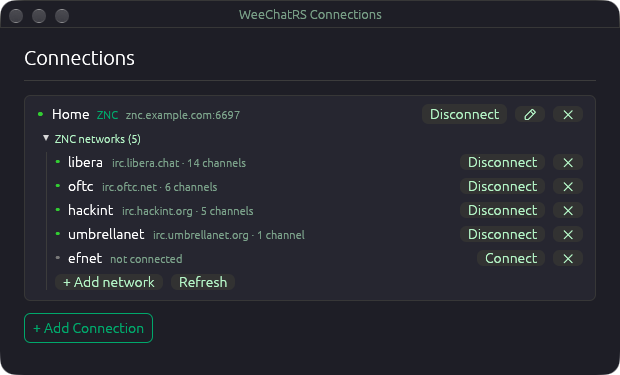

# Bouncers: soju and ZNC

WeeChatRS connects to [soju](https://soju.im/) and [ZNC](https://znc.in/) as an **IRC** connection, and uses what each bouncer offers once it recognises it. On both, logging in with just your username opens every network, each in its own group in the buffer list. Put a network in the username (`alice/libera`) and only that one opens.

- [soju](#soju)
- [ZNC](#znc)
  - [All your networks from one login](#all-your-networks-from-one-login)
  - [Managing networks](#managing-networks)
  - [History and unread lines](#history-and-unread-lines)

## soju

Add soju as an **IRC** connection with your soju username and password.

| Feature | Behaviour |
| :--- | :--- |
| All networks from one login | With `soju.im/bouncer-networks`, WeeChatRS lists your networks (`BOUNCER LISTNETWORKS`) and opens a connection bound to each one (`BOUNCER BIND`). Every network gets its own group in the buffer list, headed by its name. |
| Live network changes | With `soju.im/bouncer-networks-notify`, networks added or removed in soju appear or disappear right away, and a network's connection state and errors show in its server buffer. |
| One network only | Put the network in the username (`username/network`) to connect to just that network. |
| Read markers | `draft/read-marker` (or the older `soju.im/read`): opening a buffer sends `MARKREAD`, so the read position is shared with your other soju clients, and unread counts after a reconnect start from it. |
| History | `chathistory` fills each channel and private conversation on connect, and *Load older messages* fetches more. |
| Server-side search | With `soju.im/search`, the search bar (`⌘/Ctrl + F`) searches soju's history of the current buffer or the whole network. Click a result to load the conversation around it. |

## ZNC

WeeChatRS recognises ZNC by the `znc.in/*` capabilities it offers, and labels the connection **ZNC** in the Connections window. Add it as an **IRC** connection: your ZNC username in *Username*, your ZNC password in *Password*, SSL as your ZNC listener is set up.

### All your networks from one login

Log in with just your ZNC username (`alice`) and WeeChatRS opens every network of that user:

1. The login asks ZNC for the user's networks (`/znc ListNetworks`).
2. Each network gets a connection of its own, logged in as `alice/<network>`, with its own group in the buffer list, headed by the network's name.
3. The login itself stays connected as the *control* connection. Its server buffer shows only what ZNC's modules say (`*status`, `*controlpanel`, …). ZNC always attaches a login to one of the networks, but that network's chat comes in on the network's own connection, so nothing shows twice.

Talk to ZNC from the control buffer as in any client: `/znc help`, `/znc ListNetworks`, or `/msg *controlpanel help`. To connect to one network only, put it in the username (`alice/libera`).

### Managing networks

While a ZNC connection is up, its card in **Connections** (`⌘⇧C` / `Ctrl+Shift+C`) lists the user's networks: a green dot when ZNC is connected to the network's IRC server, its server and how many channels it is in. From there you can:

- **Add network**: a name and a first server (host, port, TLS, optional server password). WeeChatRS sends `AddNetwork` and `AddServer` to `*controlpanel`, and the new network appears in the buffer list once ZNC has connected.
- **Delete** a network (✕, then confirm) with `DelNetwork`. Its buffers close.
- **Connect** / **Disconnect** a network: ZNC joins or leaves its IRC server (`Reconnect` / `Disconnect`).
- **Refresh** the list. ZNC doesn't announce changes, so Refresh picks up changes made from another client or the web admin. Changes made here refresh it by themselves.

ZNC's answer to the last command shows under the list. Managing networks needs ZNC's `controlpanel` module (`/znc LoadMod controlpanel`). The server address is the one ZNC connects to, as seen from the ZNC host.

### History and unread lines

| Feature | Behaviour |
| :--- | :--- |
| Buffer replay | ZNC's replay of a channel or conversation (`znc.in/playback` batches) goes in as history: it counts as unread, mentions included, but doesn't send notifications. |
| Playback module | With the [playback module](https://github.com/jpnurmi/znc-playback) (`znc.in/playback`), WeeChatRS asks for everything ZNC has kept (`PLAY * 0`) after connecting, instead of ZNC's replay on join. You then get the whole buffer even when another client has already seen it, and ZNC doesn't clear it. Recommended, with `AutoClearChanBuffer` and `AutoClearQueryBuffer` off. |
| clientbuffer module | With the [clientbuffer module](https://github.com/CyberShadow/znc-clientbuffer), each device gets only the lines it hasn't seen. Put a client name in the username (`alice@laptop`, or `alice@laptop/libera` for one network), with a different name on each device, and load the module on every network with `autoadd` or `AddClient`. The login that lists your networks goes in as `alice@laptop-ctl`: ZNC attaches it to your first network, and under the same name it would take that network's replay before the network's own connection could. With the playback module loaded too, `PLAY` returns only the unseen lines. |
| Read position | ZNC doesn't keep one, so WeeChatRS remembers when you last read each buffer. After a reconnect, only lines since then count as unread. Kept per device. |
| Your own messages | `znc.in/self-message`: what you send from another client shows up here too. |
